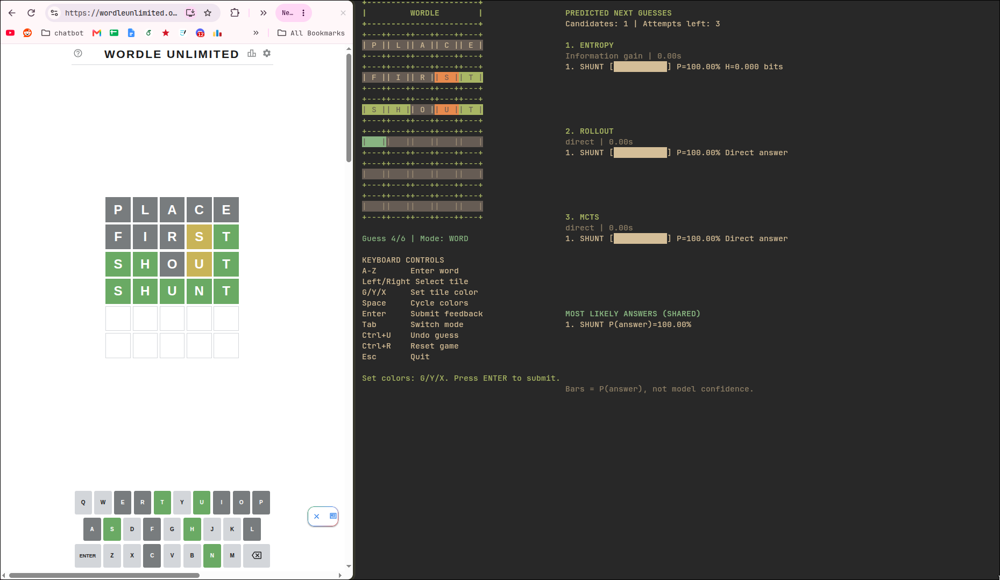
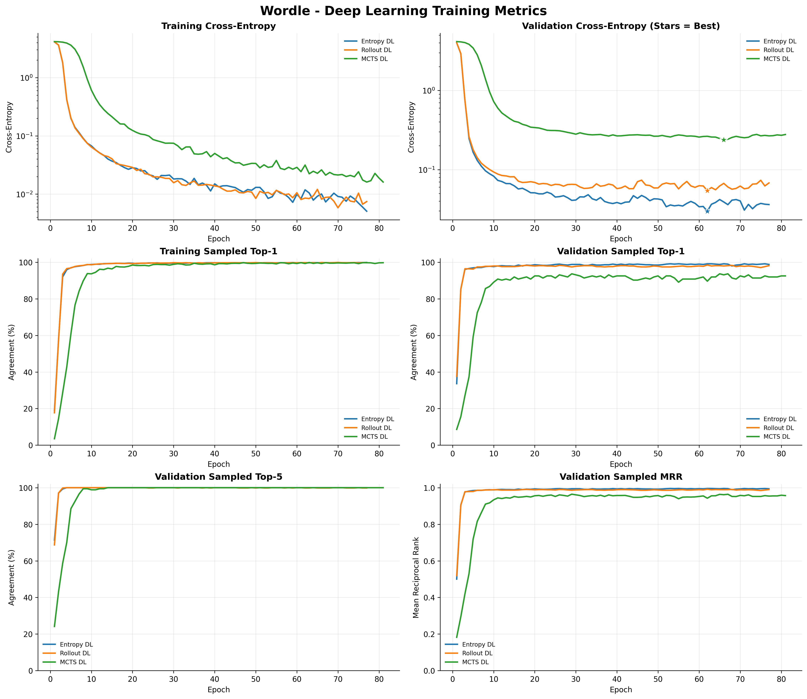
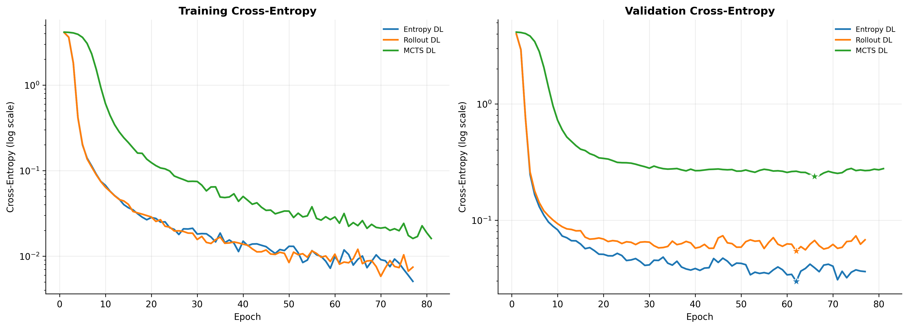
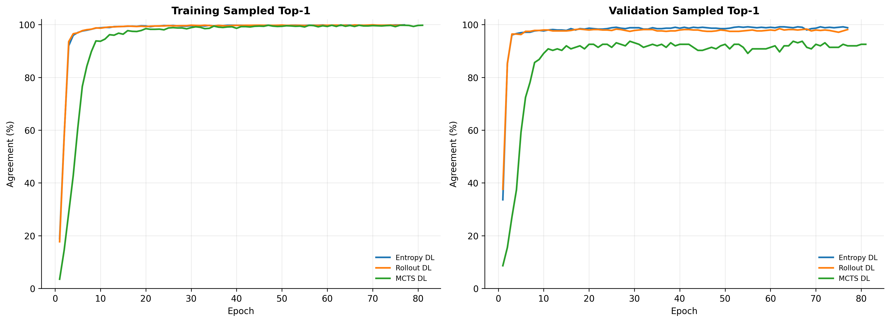
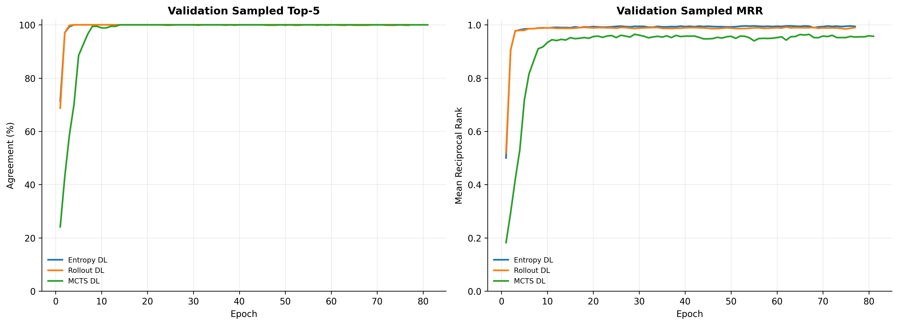
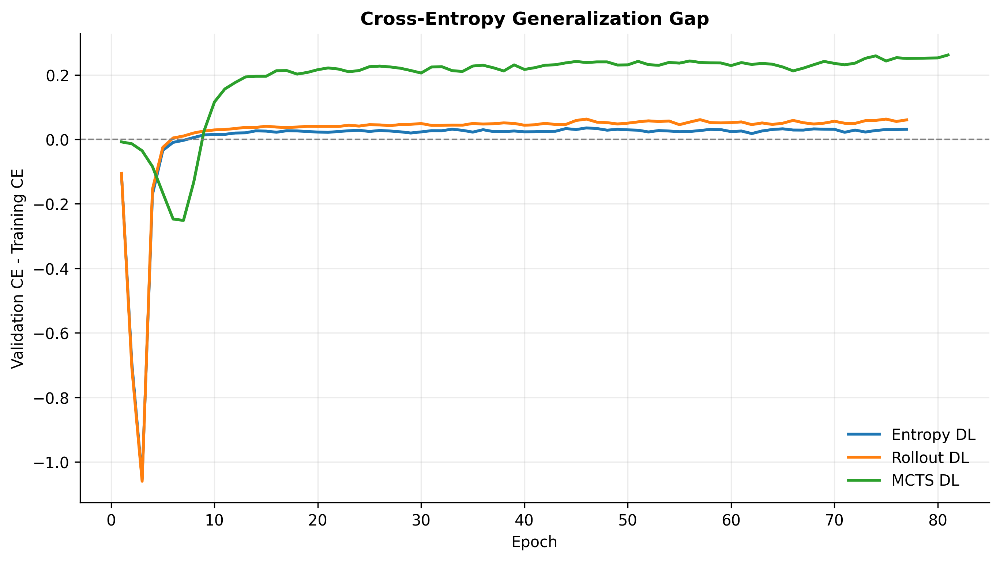

# Wordle AI — Reinforcement Learning & Deep Learning

This project explores how planning agents and neural networks solve Wordle. Entropy, rollout, and tree-search agents play simulated games and generate demonstrations. Neural student policies learn to select guesses from those demonstrations.

## Features

- Play Wordle in the terminal or simulate games with the same tile feedback.
- Compare entropy-based guess selection, model-based rollout, and Monte Carlo Tree Search (MCTS).
- Guide MCTS with an optional neural value estimator.
- Collect teacher demonstrations, train neural policies through distillation, and compare students trained from different teachers.
- Enter guesses and colored feedback in an interactive terminal solver to see ranked suggestions.

## Project Preview



*The interactive solver shows colored feedback tiles, possible answers, and ranked guesses from the planning agents.*

## Installation / Setup

1. Clone the repository and enter its root.

   ```bash
   git clone https://github.com/nabii-nguyenn213/wordle.git
   cd wordle
   ```

2. Create and activate a Python virtual environment. This project uses Python 3.10 
    **Python Virtual environment (venv)
    ```bash 
    python3.10 -m venv .venv
    source .venv/bin/activate
    ```
    **Conda**
    ```bash
    conda create -n wordle-ai python=3.10 -y
    conda activate wordle-ai
    ```

3. Install the dependencies directly with pip.

   ```bash
   pip install -r requirements.txt   
   ```

4. Use the included [word list](./dataset/wordle.csv), a CSV with `word`, `occurrence`, and `day` columns. The loader reads words and frequency weights from the first two columns. The included [demonstrations](./dataset/data_from_rl/) contain encoded states (`X`), teacher guesses as vocabulary indices (`y`), and metadata including the vocabulary and answer splits.

   The game, standard solver, and student training can start without a checkpoint. Learned MCTS uses the optional `results/wordle_value.pt` checkpoint, which is present in the working copy and can be generated after cloning.

   ```bash
   python -m ai.rl.train_value
   ```

## Usage

Run these commands from the repository root.

### Play Wordle or use the solver

```bash
python -m games.wordle
python -m games.wordle_solver
```

The solver ranks guesses from Entropy, Rollout, and MCTS side by side. Type a five-letter guess, enter tile feedback with `g` (green), `y` (yellow), and `x` (gray), then press Enter.

To enable Learned MCTS in the solver, supply the value checkpoint.

```bash
python -m games.wordle_solver --checkpoint results/wordle_value.pt
```

### Collect teacher demonstrations

Each run writes a compressed `.npz` dataset and a gameplay CSV. These examples use a separate output directory to preserve the supplied datasets.

```bash
python -m ai.dl.data_collector --teacher entropy --n-games 200 --output-dir results/new_demonstrations
python -m ai.dl.data_collector --teacher rollout --n-games 200 --output-dir results/new_demonstrations
python -m ai.dl.data_collector --teacher mcts --n-games 200 --output-dir results/new_demonstrations
python -m ai.dl.data_collector --teacher learned-mcts --n-games 200 \
  --checkpoint results/wordle_value.pt --output-dir results/new_demonstrations
```

### Train students

Train one policy per supplied teacher dataset. The trainer selects a checkpoint by validation loss and saves a training-history CSV.

```bash
for teacher in entropy rollout learned-mcts; do
  student="$teacher"
  if [ "$teacher" = learned-mcts ]; then student=mcts; fi
  python -m ai.dl.trainer \
    --input "dataset/data_from_rl/${teacher}_demonstrations.npz" \
    --output "results/student_runs/${student}_student.pt"
done
```

The saved comparison uses `entropy_student.pt`, `rollout_student.pt`, and `mcts_student.pt` under `results/dl_checkpoints/`. The MCTS student was trained on the Learned MCTS demonstrations.

### Generate training plots

The plotter reads training-history CSVs and writes figures and a metrics summary. To plot a fresh training run, point `--input-dir` at its output directory.

```bash
python -m ai.dl.plotter --input-dir results/dl_checkpoints --output-dir results/dl_plots
```

### Run benchmarks and evaluation

```bash
python -m utils.benchmark
python -m utils.evaluate_value
```

The benchmark runs Entropy, Rollout, and MCTS on the same 20 sampled answers and reports wins, guesses, and planning time. The value evaluation uses `results/wordle_value.pt` and reports MAE and RMSE. The student trainer also evaluates its best checkpoint on up to 20 stored test answers by default. Use `--eval-games 0` to skip gameplay evaluation during training.

## Models

| Model | Type | Purpose |
| --- | --- | --- |
| Entropy | Heuristic | Information-gain baseline |
| Rollout | Model-based planning | Estimate future guessing costs |
| MCTS | Tree search | Plan using simulations |
| Learned MCTS | Neural-guided planning | Estimate remaining cost during search |
| Deep Learning Students | Neural policies | Learn guess selection from teacher demonstrations |

## Training Results and Metrics

### Student validation

The table uses the epoch with the lowest validation cross-entropy for each student. Values are rounded from the [metrics summary](./results/dl_plots/metrics_summary.csv). Training histories are in [results/dl_checkpoints](./results/dl_checkpoints/).

| Student | Best epoch | Validation CE | Sampled Top-1 | Sampled Top-5 | Sampled MRR |
| --- | ---: | ---: | ---: | ---: | ---: |
| Entropy DL | 62 | 0.0298 | 99.15% | 100.00% | 0.9957 |
| Rollout DL | 62 | 0.0542 | 98.46% | 99.83% | 0.9915 |
| MCTS DL | 66 | 0.2383 | 93.10% | 100.00% | 0.9617 |

- **Training and validation cross-entropy** measure how much probability the student assigns to the teacher’s guess among the sampled choices. Lower is better.
- **Sampled Top-1 and Top-5 agreement** measure how often the teacher’s guess ranks first or among the first five choices, respectively.
- **Mean Reciprocal Rank (MRR)** averages the reciprocal of the teacher guess’s rank. A score of 1 means the teacher’s guess always ranks first.
- **Generalization gap** is validation cross-entropy minus training cross-entropy. A positive gap indicates higher loss on held-out data.



<details>
<summary>Individual metric plots</summary>









</details>

### Teacher gameplay

The validation scores above measure imitation at individual decision points. Gameplay win rate instead counts complete games solved within six guesses. The figures below come from the teachers’ saved demonstration-collection logs. The runs have different episode counts, and the average includes losses.

| Teacher | Episodes | Wins | Win rate | Mean guesses |
| --- | ---: | ---: | ---: | ---: |
| Entropy | 4,000 | 3,746 | 93.65% | 4.359 |
| Rollout | 4,000 | 3,758 | 93.95% | 4.357 |
| Learned MCTS | 800 | 721 | 90.12% | 4.498 |

## Project Structure

```text
.
├── ai/
│   ├── rl/                      # Environment, planning agents, and value network
│   └── dl/                      # Demonstration collection, policies, training, and plotting
├── assets/                      # Solver screenshot
├── dataset/
│   ├── wordle.csv               # Word list and frequency weights
│   └── data_from_rl/            # Teacher datasets and gameplay logs
├── games/
│   ├── wordle.py                # Playable terminal game
│   └── wordle_solver.py         # Interactive solver
├── results/
│   ├── dl_checkpoints/         # Student checkpoints and training histories
│   ├── dl_plots/               # Training figures and metrics summary
│   └── wordle_value.pt         # Optional Learned MCTS checkpoint
└── utils/
    ├── benchmark.py            # Planning-agent benchmark
    └── evaluate_value.py       # Value estimator evaluation
```

## Notes / Limitations

- The solver falls back to entropy when there are more than 12 candidates for Rollout or 10 for MCTS by default. The thresholds can be changed with `--rollout-threshold` and `--mcts-threshold`.
- Student validation ranks the teacher’s guess among a fixed sample of alternatives for each state. Each validation state uses the same sampled choices across epochs.
